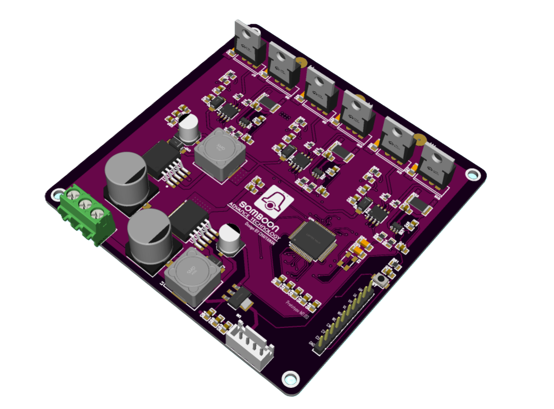

# ESC-FOC-Drive-V02

**STM32F405 three-phase BLDC/FOC engineering platform พร้อม Arduino six-step และแอป SAT motor pilot สำหรับ Windows**

[ดาวน์โหลดแอป](https://github.com/poommyroboticcamera-netizen/ESC-FOC-Drive-V02/releases/tag/v1.0.0-app) · [เลือก Firmware](#firmware-ที่มีให้เลือก) · [วิธีใช้แอป](#เริ่มใช้งาน-sat-motor-pilot) · [Hardware](hardware/README.md) · [รุ่นเก่า](#รุ่นเก่าที่ยังเก็บไว้)

---

## รุ่นแนะนำ: v1.0.0-app

รุ่นนี้เพิ่ม **SAT motor pilot** สำหรับดูสถานะ จูนค่าเริ่มต้น ควบคุม six-step และบันทึก phase telemetry ผ่าน USB CDC พร้อม firmware <code>v33-proto1</code> ที่ใช้คู่กันโดยเฉพาะ

ดาวน์โหลดแยกตามรุ่นจาก [GitHub Releases](https://github.com/poommyroboticcamera-netizen/ESC-FOC-Drive-V02/releases) โดย **หนึ่ง Release มีไฟล์ของรุ่นนั้นเท่านั้น**:

| Release / เวอร์ชัน | ไฟล์ดาวน์โหลด | ใช้สำหรับ |
|:--|:--|:--|
| [SAT motor pilot v1.0.0](https://github.com/poommyroboticcamera-netizen/ESC-FOC-Drive-V02/releases/tag/v1.0.0-app) | <code>SAT-motor-pilot-1.0.0-win-x64.exe</code> | แอป Windows x64 แบบ portable |
| [Arduino six-step app v33-proto1](https://github.com/poommyroboticcamera-netizen/ESC-FOC-Drive-V02/releases/tag/arduino-sixstep-app-v33-proto1) | <code>stm32f405-sixstep-app-v33-proto1.zip</code> | Firmware ที่ใช้คู่กับแอปเท่านั้น |
| [Arduino six-step current v1](https://github.com/poommyroboticcamera-netizen/ESC-FOC-Drive-V02/releases/tag/arduino-sixstep-current-v1) | <code>stm32f405-sixstep-current-v1.zip</code> | Six-step ผ่าน Serial Monitor แบบวัดกระแส; **ไม่ใช้กับแอป** |
| [Arduino six-step no-current v1](https://github.com/poommyroboticcamera-netizen/ESC-FOC-Drive-V02/releases/tag/arduino-sixstep-no-current-v1) | <code>stm32f405-sixstep-no-current-v1.zip</code> | Six-step ผ่าน Serial Monitor แบบไม่วัดกระแส; **ไม่ใช้กับแอป** |

ค่า SHA-256 ของไฟล์อยู่ในคำอธิบาย Release แต่ละรายการ ดาวน์โหลดเฉพาะรุ่นที่ต้องการและอย่าแฟลช firmware หลายรุ่นรวมกัน

> [!IMPORTANT]
> SAT motor pilot รองรับเฉพาะ <code>fw=v33-proto1</code>, <code>protocol=1</code> และ <code>current_protection=OFF</code> แอปจะปฏิเสธ firmware คนละรุ่นเพื่อไม่ให้ส่งคำสั่งผิดโปรโตคอล

## Firmware ที่มีให้เลือก

| Profile | Source | Current sense | วิธีควบคุม | สถานะ |
|:--|:--|:--|:--|:--|
| App v33 | [stm32f405_sixstep_app_v33](arduino_sixstep_releases/stm32f405_sixstep_app_v33) | Diagnostic เท่านั้น, ยังไม่ยืนยันหน่วย A | SAT motor pilot | รุ่นแนะนำสำหรับแอป |
| Current | [stm32f405_sixstep_current](arduino_sixstep_releases/stm32f405_sixstep_current) | INA181 U/V/W + software trip | Serial Monitor | Bench bring-up |
| No current | [stm32f405_sixstep_no_current](arduino_sixstep_releases/stm32f405_sixstep_no_current) | ปิด ไม่อ่าน PC0/PC1/PC2 | Serial Monitor | Logic/gate test |
| Custom VESC | [vesc_firmware_custom](vesc_firmware_custom) | Board-specific current path | VESC Tool / terminal | งานพัฒนาแยก |

อ่านรายละเอียดการเลือกและแฟลชที่ [Arduino six-step release guide](arduino_sixstep_releases/README_TH.md)

- **App v33** มี heartbeat 1500 ms, watchdog, telemetry, phase stream และ scope capture
- **Current** มี zero calibration และ software trip แต่ไม่ใช่ hardware short-circuit protection
- **No current** ไม่มี current feedback หรือ software trip ต้องจำกัดกระแสด้วยแหล่งจ่ายภายนอก
- **Custom VESC** เป็น codebase คนละสาย ห้ามแฟลชสลับโดยไม่ตรวจ target และคู่มือ

ไลบรารี [SolidGeek/VescUart](https://github.com/SolidGeek/VescUart) ไม่ได้ใช้กับ SAT motor pilot เพราะ VescUart ใช้ VESC binary packet protocol ส่วนแอปนี้ใช้ ASCII protocol ของ <code>v33-proto1</code> ผ่าน USB CDC

## เริ่มใช้งาน SAT motor pilot

### 1. แฟลช firmware ที่ตรงกับแอป

1. ดาวน์โหลด <code>stm32f405-sixstep-app-v33-proto1.zip</code> แล้วแตกไฟล์
2. เปิด <code>stm32f405_sixstep_app_v33.ino</code> ด้วย Arduino IDE 2
3. ติดตั้งแพ็กเกจ **STM32 MCU based boards** ของ STMicroelectronics
4. เลือก Board <code>Generic STM32F4 series</code>, part <code>Generic F405RGTx</code>
5. เลือก USB <code>CDC (generic Serial supersede U(S)ART)</code> และ Low/Full Speed
6. เลือก <code>STM32CubeProgrammer (SWD)</code> เมื่อใช้ ST-LINK
7. กด **Verify** ก่อน Upload โดยยังไม่ต่อมอเตอร์และไม่จ่าย DC bus

### 2. เปิดแอป

1. ดาวน์โหลด <code>SAT-motor-pilot-1.0.0-win-x64.exe</code>
2. เปิดไฟล์ แอปเป็น portable ไม่ต้องติดตั้ง Python
3. ต่อ STM32F405 ด้วยสาย USB data
4. กดรีเฟรช เลือก COM ของบอร์ด แล้วกด **Connect board**
5. แอปตรวจ HELLO, เริ่มส่ง HEARTBEAT, อ่าน STATUS และเปิด phase stream อัตโนมัติ

ถ้าเปิด COM ไม่ได้ ให้ปิด Arduino Serial Monitor, Arduino IDE, browser tab หรือ SAT motor pilot หน้าต่างอื่นที่กำลังใช้พอร์ตเดียวกัน แล้วตรวจ COM number ใน Windows Device Manager

### 3. ทดสอบมอเตอร์

1. ใช้แหล่งจ่ายแรงดันต่ำและ current limit ต่ำ
2. เตรียมสวิตช์ตัด DC bus ที่เอื้อมถึงได้
3. เชื่อมต่อแอปและตรวจว่าสถานะเป็น <code>DISARMED</code>
4. กด ARM แล้วตั้ง duty/startup profile ต่ำ
5. กด RUN และเฝ้าดู state, fault, duty, phase ADC และ BEMF lock
6. กด STOP ทันทีเมื่อมอเตอร์สั่น ค้าง ร้อน หรือกระแสเพิ่มผิดปกติ

ค่า Phase U/V/W เป็น raw ADC counts ไม่ใช่แรงดันที่สอบเทียบแล้ว ค่า current, RPM, bus voltage และ temperature ที่ยังไม่ยืนยันจะแสดงเป็น N/A แอปไม่สร้างค่าจำลอง

## ฟังก์ชันของแอป

- ARM / RUN / STOP และ signed duty
- Direction, initial startup period, acceleration ramp และ duty response
- State, fault, commutation timing, BEMF lock และ heartbeat
- Phase U/V/W live trend สูงสุดประมาณ 10 samples/s
- Scope snapshot สูงสุด 512 PWM-ON samples และ live short captures
- Export CSV จากข้อมูลที่รับจริง
- Serial console สำหรับ diagnostic
- English/Thai UI

ซอร์สอยู่ใน [bldc_tuner_windows](bldc_tuner_windows) หากต้องการรันผ่าน browser ให้เปิด <code>Start SAT motor pilot.bat</code> โดยมี Python 3 หรือ build Electron ด้วย <code>npm install</code> และ <code>npm run dist:win</code> ใน <code>bldc_tuner_windows/electron-shell</code>

## Hardware overview

| รายการ | รายละเอียด |
|:--|:--|
| MCU | STM32F405RGT6, ARM Cortex-M4F |
| Power stage | Three-phase, six MOSFET bridge |
| Gate driver | EG3112D จำนวน 3 ช่อง |
| Current sense | INA181A1 gain 20 V/V, shunt 1 mΩ x3 |
| Interfaces | USB CDC, CAN, PPM, SWD |
| Main bring-up target | 24 V class, low-power controlled bench |

### Hardware pin map

| Function | STM32F405 pin |
|:--|:--|
| High-side U / V / W | PA8 / PA9 / PA10 |
| Low-side U / V / W | PB13 / PB14 / PB15 |
| Current U / V / W | PC0 / PC1 / PC2 |
| Phase voltage U / V / W | PA0 / PA1 / PA2 |
| Stop SW3 / SW4 | PC4 / PC5, active LOW |
| USB FS DM / DP | PA11 / PA12 |
| CAN1 RX / TX | PB8 / PB9 |
| SWDIO / SWCLK | PA13 / PA14 |

ไฟล์ผลิตและแบบวงจร:

- [Hardware guide](hardware/README.md)
- [Schematic ล่าสุด](hardware/SCH_drive_2026-09-22.pdf)
- [PCB PDF ล่าสุด](hardware/PCB_V02_2026-09-22.pdf)
- [BOM](hardware/BOM_BLDCv02.xlsx)
- [Pick-and-Place](hardware/PickAndPlace_BLDCV02.xlsx)
- [Gerber](hardware/Gerber_BLDCV02.zip)

## รุ่นเก่าที่ยังเก็บไว้

รุ่นใหม่ไม่ทับหรือลบ source เดิม:

| โฟลเดอร์เดิม | เนื้อหา |
|:--|:--|
| [arduino_stm32f405_bldc_test](arduino_stm32f405_bldc_test) | STM32F405 open-loop bring-up รุ่นเดิม |
| [arduino_eg2132_bldc_test](arduino_eg2132_bldc_test) | Arduino Uno/Nano gate-input test รุ่นเดิม |
| [vesc_firmware_custom](vesc_firmware_custom) | Custom VESC source, reports และงานพัฒนาเดิม |

หากต้องย้อนกลับ ให้ checkout commit/tag ที่ต้องการหรือใช้ source ในโฟลเดอร์เดิม ห้ามสมมติว่า protocol และคำสั่งของแต่ละรุ่นเข้ากันได้

## โครงสร้าง Repository

    arduino_sixstep_releases/         Current / no-current / app-v33 profiles
    bldc_tuner_windows/               SAT motor pilot source
    arduino_stm32f405_bldc_test/      Legacy STM32 bring-up (kept)
    arduino_eg2132_bldc_test/         Legacy external Arduino test (kept)
    vesc_firmware_custom/             Custom VESC development tree
    hardware/                         Schematic, PCB, BOM, PnP, Gerber
    docs/assets/                      README images

Generated executables, Electron dependencies, build output และ temporary files ไม่ถูก commit; ดาวน์โหลด binary จาก GitHub Releases

## สถานะการตรวจสอบ

| รายการ | ผล |
|:--|:--|
| SAT motor pilot JavaScript syntax | ผ่าน |
| Python localhost launcher | ผ่าน, HTTP 200 |
| Electron Windows x64 portable build | ผ่าน |
| App ↔ firmware handshake fields | ตรวจความสอดคล้องแล้ว |
| Release ZIP structure / SHA-256 | ผ่าน |
| Arduino v1 profiles compile ในรอบ release นี้ | ต้องกด Verify ใน Arduino IDE เนื่องจากเครื่อง build ไม่มี Arduino CLI |
| ทดสอบกับบอร์ดและมอเตอร์จริง | ยังต้องดำเนินการ |

การ compile และเปิดแอปได้ไม่ยืนยัน ADC timing, dead time, gate waveform, current accuracy หรือ fault response บนภาคกำลังจริง

## คำเตือนด้านความปลอดภัย

> [!CAUTION]
> โครงการนี้เป็น engineering prototype ไม่ใช่ ESC production หรือระบบ safety-rated ภาคกำลังสามารถสร้างกระแสสูง ความร้อน แรงดันย้อนกลับ และการหมุนโดยไม่คาดคิด

- ใช้ฟิวส์ แหล่งจ่ายจำกัดกระแส และสวิตช์ตัด DC bus
- ตรวจ gate input และ gate waveform โดยไม่ต่อมอเตอร์ก่อน
- ใช้ differential/isolated probe เมื่อวัด high-side ห้ามต่อ oscilloscope ground clip เข้ากับ phase node หรือ HO
- Software trip, watchdog, heartbeat และปุ่ม STOP ไม่ทดแทน hardware over-current shutdown
- ห้ามเพิ่ม duty เพื่อฝืนมอเตอร์ที่ stall หรือสั่น
- ยังไม่อนุมัติให้ใช้กับ automotive, medical, human-carrying หรือระบบ safety-critical

ไม่มี repository-wide license สำหรับไฟล์เฉพาะโครงการ การเปิดเป็น public ไม่ได้ให้สิทธิ์ใช้งานหรือแจกจ่ายโดยอัตโนมัติ ส่วน VESC และ third-party components อยู่ภายใต้ license ของต้นทาง
